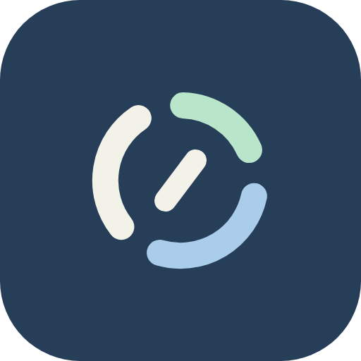
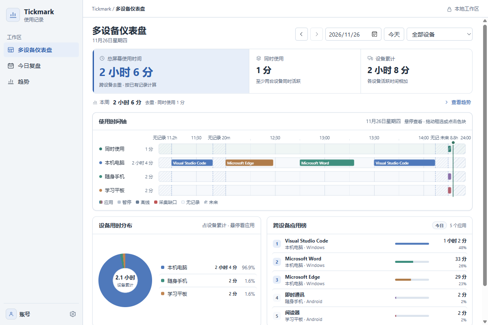
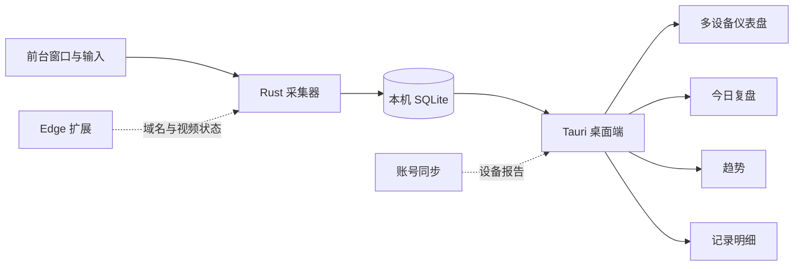

<p align="center">
  
</p>

<h1 align="center">Tickmark Desktop</h1>

<p align="center">
  <strong>多设备使用记录的桌面中枢</strong><br>
  看清一天里，自己在哪些设备、哪些应用上花了多少时间。
</p>

<p align="center">
  
  
  
  
  
</p>

> 记录事实，不评判用户。Tickmark 只回答「用了什么、用了多久、发生在哪个时间段」，解释权留给使用者。

Tickmark Desktop 是一个本地优先的多设备使用记录工具。电脑通过独立的 Rust 采集器记录前台应用、空闲、锁屏和可识别的文档；手机与平板通过账号同步或导入报告加入同一批报表。默认首页是多设备仪表盘，而不是一堆需要自己拼接的报表。

<p align="center">
  
</p>
<p align="center"><sub>多设备仪表盘：一天的使用时间轴、设备分布与跨设备应用榜</sub></p>

## 核心界面

| 页面 | 用途 |
| --- | --- |
| **多设备仪表盘** | 默认入口。当天跨设备去重用时、共用时间轴、设备用时饼图、跨设备应用榜和本周上下文。 |
| **今日复盘** | 分时摘要、应用用时，以及站点和文档明细。 |
| **趋势** | 周/月每日趋势、小时分布、三类排行、设备覆盖和并发分析。 |
| **记录明细** | 原始区间的证据层，从时间轴选区、今日复盘或设置进入，不占一级导航。 |
| **设置** | 本机采集、浏览器扩展、账号同步、数据库、其他设备和数据质量。 |

日期和设备筛选在仪表盘、今日复盘、趋势之间共享，切换页面时不会丢失范围。

## 时间轴

时间轴是首页的主图，也是 Tickmark 最核心的交互。

- **所有设备共用当地时间刻度**，多设备时增加「同时使用」轨道。
- **悬停**只显示虚线游标和「此刻」应用；**拖动框选或点击色块**进入聚焦，整条轴放大到所选范围。
- 聚焦后，轴下方固定展示「已选时段 · 应用排行」，可以继续放大、查看记录或按 `Esc` 返回全天。
- **短切换平滑**：同一设备、同一应用 2 秒内的相邻区间自动合并；夹在同一应用之间、持续不超过 2 秒的未识别间隙或短暂切换也会并入。真实样本中，一段被切碎成上百段的小红书使用记录会合并成一条连续色块。
- **长时间无活动折叠**：睡眠、无记录和未来等最长 4 段、每段至少 20 分钟的无活动区间会压缩显示，把空间留给真正有内容的时间段。折叠段支持悬停查看真实起止，点击可聚焦。
- 平滑和折叠只影响时间轴显示；记录明细和统计仍使用原始区间。

## 为什么是仪表盘

- **一天优先**：先回答「今天怎么样」，再看周/月趋势。
- **时间轴优先**：先看到时间花在哪里，再去看排行和明细。
- **原始记录是证据层**：需要核对时一键进入，不需要时不占导航。
- **范围一致**：同一个日期和设备筛选贯穿全应用，避免不同页面给出对不上的数字。
- **本地优先**：默认数据留在本机，账号同步是可选项。

## 架构



- **采集器**：独立进程，记录 Windows 前台应用、空闲、锁屏、视频/放映豁免和清洗后的文档标题；关闭窗口后继续运行。
- **桌面端**：Tauri + WebView2，界面静态文件随程序编译，没有前端构建步骤。
- **多设备**：本机 SQLite、导入的设备报告和账号同步的云端设备合并到同一批区间。
- **账号同步**：邮箱验证码登录，刷新令牌用 Windows DPAPI 加密保存；退出后离开云端报表。
- **Edge 扩展**：补充浏览器域名和视频播放状态；路径、查询参数和标题不传。

## 快速开始

### 环境

- Windows 10/11
- WebView2 Runtime
- 可用的 Rust MSVC 工具链
- Node.js 24+（仅运行报表测试）

### 构建与运行

```powershell
powershell.exe -NoProfile -ExecutionPolicy Bypass -File scripts/rust.ps1 build --workspace --locked
.\artifacts\rust\debug\tickmark-desktop.exe
```

如果 `cargo` 和 `rustc` 不在 `PATH`，设置 `TICKMARK_RUST_BIN` 指向工具链的 `bin` 目录，或写入 `.tools/rust-bin.txt`。

应用数据默认保存在 `%LOCALAPPDATA%\TickmarkDesktop`。采集由界面里的「开始采集」启动，当前没有开机自启。

### 命令行

安装包会把桌面端与 `tickmark.exe` 放在同一目录，并把该目录加入当前用户 PATH。安装完成后新开一个终端即可使用，不需要管理员权限：

```powershell
tickmark status
tickmark report --date today
tickmark query apps --range week --top 10
```

不安装时也可以直接运行构建产物，这种方式不会改动 PATH：

```powershell
.\artifacts\rust\debug\tickmark.exe devices
```

命令面、输出契约、安装与卸载行为见 [命令行界面](docs/cli.md)；给 AI 或脚本接入时直接提供 [AI 接入说明](docs/cli-agent.md)。

### 测试

```powershell
node --test native/tests/dashboard.test.mjs
```

## 项目结构

```text
native/
  capture/        Rust 采集器、托盘、SQLite 与 Windows 集成
  report/         共享报表核心：设备读取、口径、聚合与时间轴
  cli/            命令行入口 tickmark.exe
  ui/             Tauri 桌面壳
  web/            无构建步骤的 WebView 界面
  edge-extension/ Edge 域名与视频状态扩展
  tests/          Node 报表测试与 WebView 验收
docs/             规则、报表、同步、验收与界面结构文档
scripts/          构建与扩展注册脚本
```

## 文档

| 文档 | 内容 |
| --- | --- |
| [界面结构与导航](docs/interface.md) | 页面职责、共享范围、时间轴展示规则与命名约定 |
| [多设备仪表盘](docs/multi-device-dashboard.md) | 首页布局、时间轴交互、短切换平滑与无活动折叠 |
| [设备与统计报表规则](docs/reports.md) | 设备身份、区间契约、统计口径和报表验收 |
| [构建、运行与验证](docs/rust-desktop.md) | 进程边界、托盘、开发环境与实机验证 |
| [桌面面板与验收记录](docs/dashboard-review.md) | 界面迭代、截图检查和问题修正记录 |
| [Windows 使用计时设计](docs/windows-usage-capture.md) | 前台、空闲、锁屏、视频豁免和页面识别 |
| [跨端同步规则](docs/sync.md) | 邮箱账号、设备鉴权、修订、删除和下行 |
| [命令行界面](docs/cli.md) | GUI + CLI 双入口、命令面、输出契约、安装与卸载 |
| [AI 接入说明](docs/cli-agent.md) | 给 AI 与脚本的一页契约：参数、JSON 字段、SQL 表结构、系统提示 |
| [系统规则索引](docs/README.md) | 所有规则文档的入口与变更记录 |

## 当前状态

- Windows 本机采集、托盘、Edge 扩展和多设备报表已可用。
- 命令行 `tickmark` 与桌面端共享报表核心，可查询、聚合、导出并执行只读 SQL。
- 账号同步、Android 上行和 Windows 收发已实现；生产邮件已配置，真机后台行为仍需单独验证。
- 待实现：前后周期对照、应用/站点钻取、并行组合下钻。

## 数据与隐私

- 使用记录默认保存在本机 SQLite。
- 账号同步是可选项；不登录也可以手动导入设备报告。
- 刷新令牌通过 Windows DPAPI 加密保存，访问令牌只驻留在 Rust 内存。
- Edge 扩展只传普通 HTTP(S) 页面的域名和视频播放状态，不传路径、查询参数、标题或 IP 地址。
- 文档/项目标题默认留在本机，开启单独授权后才参与记录。

## License

当前仓库未附带开源许可证。如需复用、分发或二次开发，请先添加合适的 `LICENSE`。
