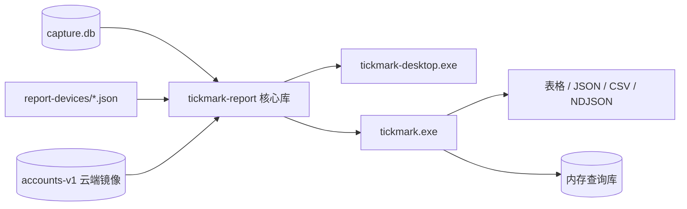

# Tickmark 命令行界面（CLI）设计

状态：已实现（v1）。本文固定形态、命令面、数据口径、安装方式与验收标准。

## 这个形态叫什么

常见的叫法是 **GUI + CLI 双入口**，也叫 **伴生命令行（companion CLI）**、**headless CLI** 或 **可脚本化接口（scriptable interface）**。`gh`、`docker`、`code` 都是这种结构：底层是一份核心能力，GUI 和命令行只是两个壳。

对 Tickmark 来说，意味着：

- `tickmark-desktop.exe`：现在的界面，负责浏览、核对和交互。
- `tickmark.exe`：同一份数据的第二个入口，负责查询、聚合、导出和脚本化。
- 两者都不拥有数据。数据在 `%LOCALAPPDATA%\TickmarkDesktop`，CLI 只读，GUI 负责采集和写入。

不是第二个应用，不复制一份数据库，也不要求 GUI 正在运行。

## 目标

- 用命令行完成任意时间范围、任意设备、任意维度的筛选与聚合。
- 输出可被 PowerShell、Python、Excel、`jq` 直接消费。
- 与界面使用同一批区间、同一套口径，数字对得上。
- 默认只读、离线、无账号依赖，出错时给得出下一步动作。
- 覆盖「临时查一下」和「写进脚本每天跑」两种使用强度。

## 非目标

- 不做实时采集守护进程（采集器已经独立运行）。
- v1 不做登录、上传、云端拉取等网络操作。
- 不提供交互式 TUI，也不做图表渲染。
- 不改变现有 SQLite 表结构，不迁移历史数据。
- 不把内部实现细节变成对外承诺；对外稳定的只有本文列出的命令和 JSON 字段。

## 现状与约束

| 项目 | 现状 |
| --- | --- |
| 工作区 | `native/Cargo.toml` 只包含 `capture` 与 `ui` 两个 crate，目标目录在 `artifacts/rust` |
| 本机数据 | `capture.db`（WAL）、`capture.db-wal`、`capture.db-shm` |
| 导入设备 | `report-devices/<device-id>.json`，文件名必须等于设备 id |
| 云端镜像 | `accounts-v1/<vault>/<sha256(account)>.sqlite3`，只在 GUI 登录并同步后更新 |
| 行模型 | `start_ms`、`end_ms`、`state`（0 正常、1 无操作、2 锁屏/离线、3 采集缺口）、`app_id`、`app_name`、`page`、`playback` |
| 区间语义 | 半开区间 `[start, end)`，跨范围查询按范围裁剪 |
| 聚合位置 | 界面在 JS 里聚合；Rust 目前只负责取行、校验和合并设备 |
| 数据目录 | `tickmark_capture::data_dir()`，已支持 `TICKMARK_DATA_DIR` 覆盖 |

关键风险是**口径分叉**：界面用 `native/web/report.mjs` 聚合，CLI 如果另写一套，很容易出现「界面 8 小时 42 分、命令行 8 小时 39 分」。因此 CLI 必须和界面共享同一份语义定义，并用测试对齐。

## 总体架构



新增两个 crate：

```text
native/
  report/        新的共享库 tickmark-report
    src/model.rs       设备、区间、状态
    src/source.rs      本机 SQLite、导入报告、云端镜像的读取与校验
    src/metrics.rs     并集、并发、覆盖、设备合计
    src/aggregate.rs   分组、时间桶、Top N
    src/timeline.rs    平滑合并与无活动折叠
    src/format.rs      时间解析、时长解析、输出格式化
  cli/           新二进制 tickmark
```

从 `native/ui` 迁入共享库的内容：

- `report_sources.rs` 的设备模型、`read`、`import`、`include_cloud`。
- `sync.rs` 中只读的 `reports(path, start, end)` 与 `CloudDevice`、`Payload` 类型；网络和写入逻辑留在 GUI。
- 时间轴常量与算法按与 `report.mjs` 相同的规则实现，测试用同一批 fixture 对齐。

`ui` 改为调用 `tickmark-report`，不得复制一份行模型。迁移分两步：先让库对 GUI 保持现有 JSON 结构，再让 CLI 接入。

## 数据来源

| 来源 | 路径 | 默认 | 新鲜度 |
| --- | --- | --- | --- |
| 本机 | `capture.db` | 总是读取 | 实时，采集器持续写入 |
| 导入设备 | `report-devices/*.json` | 总是读取 | 导入时固定 |
| 云端镜像 | `accounts-v1/**/*.sqlite3` | 默认关闭，`--cloud` 开启 | 取决于上次 GUI 同步 |

- `--cloud` 自动选择最近修改的一份镜像；存在多份时在 stderr 提示，可用 `--cloud-path` 指定。
- `--cloud` 不发起网络请求，只读本地镜像；`status` 会显示镜像时间和上次同步的大致时间。
- 设备解析顺序：`local` → 本机；精确 id → 匹配；`name:<名称>` → 按显示名匹配，重名时报错并列出候选。
- 设备筛选默认 `all`，包含本机、导入和已启用的云端镜像设备。

## 命令面

通用形态：`tickmark <命令> [子命令] [参数]`。命令和参数用英文，帮助文案和输出值保留中文。

### `tickmark status`

展示数据目录、数据库大小、采集器状态、最后一条记录时间、设备数量、云端镜像时间。

```text
$ tickmark status
数据目录      C:\Users\me\AppData\Local\TickmarkDesktop
数据库        18.4 MiB（capture.db 16.1 + WAL 2.3）
采集器        运行中
最后记录      2026-11-26 16:18:03
设备          本机 1，导入 1，云端 2（镜像 2026-11-26 15:52）
```

### `tickmark devices`

列出设备、来源、覆盖范围和区间数量。`--format json` 可供脚本判断某台设备是否有数据。

```text
$ tickmark devices
id              名称        类型      来源    首条记录             末条记录             区间数
local-windows   本机电脑     computer  本机    2025-06-01 09:12     2026-11-26 16:18     48,213
phone-01        随身手机     phone     导入    2026-10-02 07:40     2026-11-25 23:58      9,884
tablet-01       学习平板     tablet    云端    2026-11-20 18:02     2026-11-26 12:31      1,204
```

### `tickmark query intervals`

原始区间，不做任何平滑和合并，是核对数字的证据层。

```powershell
tickmark query intervals --date today --device local --state active --min-duration 5m
tickmark query intervals --from "2026-11-01 09:00" --to "2026-11-01 12:00" --app "Visual Studio Code"
```

支持筛选：`--device`、`--state`、`--app`、`--app-unidentified`、`--page-contains`、`--playback`、`--min-duration`。
默认按开始时间升序；`--sort duration` 改按时长降序。

### `tickmark query apps`

应用会话层，同一设备同一应用的相邻区间合并后输出，可选按名称跨设备合并。

```text
$ tickmark query apps --range week --top 5 --merge-apps name
应用              设备数   会话数   用时        占比
Visual Studio Code    2       41    18 小时 42 分   38.1%
Microsoft Edge        2       63     9 小时 06 分   18.6%
小红书                1       28     5 小时 12 分   10.6%
```

### `tickmark report`

与仪表盘同口径的汇总：去重总用时、设备用时、重叠用时、覆盖情况和应用/页面排行。

```text
$ tickmark report --date 2026-11-25
2026-11-25 · 全部设备
总计（去重）   8 小时 42 分
设备合计      10 小时 42 分
重叠           1 小时 58 分

设备           用时          覆盖
本机电脑       6 小时 05 分   78%
随身手机       3 小时 10 分   41%
学习平板       1 小时 27 分   19%

应用 Top 5
Visual Studio Code  4 小时 12 分
Microsoft Edge      1 小时 48 分
小红书              1 小时 06 分
```

- `--top` 控制应用和页面条数，默认 10。
- `--merge-apps none|name` 控制是否合并同名应用，`report` 默认 `name`。
- `--split-device` 输出每台设备各自的应用榜。
- `report` 只支持 `table` 与 `json`；需要归档或 CSV 时用 `export --dataset report --format json`。

### `tickmark aggregate`

自由度最高的结构化聚合：筛选 × 分组 × 指标 × 时间桶。

```powershell
# 本月每天、每台设备的正常用时
tickmark aggregate --range month --group-by day,device --metric duration

# 今天 09:00 到 18:00，每 15 分钟一条，只看 Edge 和小红书
tickmark aggregate --from "2026-11-26 09:00" --to "2026-11-26 18:00" `
  --app "Microsoft Edge" --app "小红书" --bucket 15m --group-by time

# 一周里各应用的平均单次会话长度
tickmark aggregate --range week --group-by app --metric session-avg --top 20
```

参数：

| 参数 | 说明 |
| --- | --- |
| `--group-by` | `day`、`weekday`、`hour`、`device`、`app`、`state`、`page`，逗号分隔，可组合 |
| `--bucket` | 绝对时间桶：`5m`、`15m`、`30m`、`1h`、`1d`；与 `hour` 的「一天中的第几小时」不同 |
| `--metric` | `duration`（默认）、`sessions`、`intervals`、`session-avg` |
| `--top` | 按指标取前 N 组 |
| `--sort` | `metric`（默认）或 `key` |

结果每行带 `durationMs`、`share` 和分组键；`share` 的分母固定为该次聚合全部分组的时长之和，`--top` 截断不改变分母，避免各组自算百分比后互相矛盾。

### `tickmark timeline`

与界面一致的时间轴数据：短切换平滑、长无活动折叠，供脚本生成图表或自己渲染。

```powershell
tickmark timeline --date today --format json
tickmark timeline --date today --raw            # 均匀轴、不平滑
tickmark timeline --date today --smooth 0
```

- 默认平滑 2 秒，与界面 `TIMELINE_SMOOTH_GAP_MS` 一致。
- 默认折叠最长 4 段、每段至少 20 分钟的无活动区间，与界面 `TIMELINE_SCALE` 一致；`--raw` 关闭。
- 输出区分 `items`、`quiet`；`quiet` 附带 `reason`：`sleep`（夜间长段）、`idle`（仅无操作）、`offline`（含锁屏）、`gap`（仅采集缺口）、`no-activity`（有其他非正常状态混合）、`no-record`（完全没有记录）、`future`（尚未发生）。
- 跨过当前时刻的无活动区间会拆成两段：已发生部分按记录判断，之后标记 `future`，与界面一致。
- 平滑和折叠只影响 `timeline` 输出，不影响 `query`、`report`、`aggregate` 的数字。
- `timeline` 只支持 `table` 与 `json`；需要写入文件时用 `export --dataset timeline`。

### `tickmark overlap`

跨设备并发使用：总重叠时长、设备两两重叠矩阵、最长的并发时段。

```text
$ tickmark overlap --range week --top 3
重叠总计  7 小时 24 分
本机电脑 + 随身手机  5 小时 02 分
本机电脑 + 学习平板  1 小时 18 分
随身手机 + 学习平板    41 分

最长并发
2026-11-24 21:12–22:48   96 分钟   本机电脑 + 随身手机
```

### `tickmark export`

把选定数据写入文件或标准输出。和 `query --format` 的区别是带设备清单、范围和生成时间，适合归档和交接。

```powershell
tickmark export --range month --dataset intervals --format csv --out usage.csv
tickmark export --range month --dataset apps --format ndjson | python ingest.py
```

`--dataset` 取 `intervals`、`apps`、`report`、`timeline`；`--out -` 表示标准输出。CSV 默认带 UTF-8 BOM，方便 Excel 直接打开；`--no-bom` 关闭。

### `tickmark sql`

把选定范围装入内存 SQLite，然后执行一条只读 SQL。适合临时想到的复杂聚合，不接触真实数据库文件。

```powershell
tickmark sql "select app_name, round(sum(end_ms - start_ms) / 3600000.0, 1) as hours
              from app_sessions
              where start_ms >= 1795536000000
              group by app_name order by hours desc limit 10"

tickmark sql --file weekly.sql --range month --format csv
```

内存库中的表：

| 表 | 列 |
| --- | --- |
| `devices` | `id`、`name`、`kind`、`platform`、`source`、`first_ms`、`last_ms` |
| `intervals` | `device_id`、`start_ms`、`end_ms`、`state`、`state_key`、`app_id`、`app_name`、`page`、`page_kind`、`playback` |
| `app_sessions` | `device_id`、`app_id`、`app_name`、`start_ms`、`end_ms` |

约定：

- 只允许一条语句；多条、`ATTACH`、`PRAGMA`、写操作直接拒绝，错误码为 4。
- 结果自动包一层 `LIMIT`（默认 1000，`--limit` 调整），除非语句已包含 `LIMIT`。
- 执行超过 `--timeout`（默认 10 秒）中断，并提示缩小范围或加筛选。
- 表名和列名是公开契约；真实 `capture.db` 的表结构不承诺稳定。

### `tickmark import`

导入设备报告，和界面右上角的导入走同一套校验。默认只做检查，`--write` 才落盘。

```powershell
tickmark import .\phone.json --dry-run
tickmark import .\phone.json --write
```

`--dry-run` 输出版本、设备、范围、区间数、将被替换的范围和冲突原因；`--write` 需要显式确认，避免脚本误写。

### `tickmark path`

维护用户 `PATH` 中的 Tickmark 目录。主要给安装器和卸载器调用，也方便用户手动修复。

```powershell
tickmark path --status
tickmark path --add "C:\Users\me\AppData\Local\Tickmark"
tickmark path --remove "C:\Users\me\AppData\Local\Tickmark"
```

- 只读写 `HKCU\Environment\Path`，不申请管理员权限，不碰系统级 `PATH`。
- 保留原有的 `REG_EXPAND_SZ` 类型和 `%USERPROFILE%` 这类变量，不把整条 PATH 展开后写回。
- 加入前做规范化和大小写不敏感去重；移除时只删自己那一条，不动其他目录。
- 写入后广播 `WM_SETTINGCHANGE`，让新开的终端和资源管理器读取新环境；已经打开的终端必须重开。
- 返回码：0 表示已经是目标状态或修改成功，1 表示无法读写用户环境变量。

### `tickmark completion`

生成 `powershell`、`bash`、`zsh`、`fish` 补全脚本。属于 P4 的可选项，不影响核心命令。

## 通用参数

```text
--data-dir <PATH>        数据目录，默认 %LOCALAPPDATA%\TickmarkDesktop，环境变量 TICKMARK_DATA_DIR 优先
--cloud [auto|off|<path>] 是否读取本地云端镜像，默认 off
--from <时间> --to <时间>  半开区间 [from, to)
--date <YYYY-MM-DD>      单日，等价于本地零点到次日零点
--range today|yesterday|week|month   常用范围，`week` 为本周边界（周一起），`month` 为本月；与 --date 互斥
--last <时长>            滚动窗口，如 24h、7d、30d；与 --range、--date 互斥
--tz <IANA|+08:00>       时区，默认系统本地时区
--device <all|local|id|name:名称>     可重复
--format table|json|csv|ndjson        默认终端 table，管道 json
--limit <N>              结果条数，默认 table 200 / json 1000
--fail-empty             结果为空时返回退出码 5
--wide                   表格不截断长应用名
--no-pages               输出中省略页面/文档标题
```

时间写法支持 `2026-11-26`、`2026-11-26 09:30`、RFC 3339、`today`、`yesterday`。时长写法支持 `90s`、`5m`、`1h30m`。日期按本地时区解释，跨夏令时时按真实墙上时间切日，内部统一存毫秒时间戳。

## 统计口径

CLI 必须逐条对齐 `native/web/report.mjs`：

| 概念 | 定义 |
| --- | --- |
| 正常用时 | `state = 0` 的区间并集；跨设备同时使用只算一次 |
| 设备用时 | 每台设备自身 `state = 0` 的区间并集 |
| 设备合计 | 各设备用时之和，可能大于正常用时，差额就是重叠 |
| 重叠 | 任意时刻至少两台设备同时处于 `state = 0` 的时长 |
| 覆盖 | 每台设备 `active / idle / offline / gap` 与未观测时长，未观测 = 范围时长 − 已有区间 |
| 会话 | 同一设备、同一应用、相邻且间隔不超过 2 秒的区间合并为一段 |
| 应用榜 | 默认按应用名跨设备合并；`--merge-apps none` 时按「设备 + 应用」拆开 |
| 无数据 | 范围内没有任何非缺口区间时，总计输出 `null`，而不是 0 |
| 日期 | 自然日按本地零点切分；周从周一开始；月按自然月 |
| 裁剪 | 所有查询先裁剪到 `[from, to)`，再聚合 |

会话合并的 2 秒阈值与时间轴平滑一致；界面里 `aggregateApps` 按「设备 + 应用」分组，跨设备榜单在展示层合并，CLI 用 `--merge-apps` 显式表达这个差别。

## 输出契约

### JSON

```json
{
  "schemaVersion": 1,
  "command": "report",
  "generatedAt": "2026-11-26T16:20:11+08:00",
  "range": { "from": "2026-11-25T00:00:00+08:00", "to": "2026-11-26T00:00:00+08:00", "tz": "Asia/Shanghai" },
  "scope": { "devices": ["local-windows", "phone-01"], "cloud": false },
  "totals": { "activeMs": 31320000, "overlapMs": 7080000, "deviceSumMs": 38520000 },
  "devices": [
    { "id": "local-windows", "name": "本机电脑", "activeMs": 21900000, "coverage": { "activeMs": 21900000, "unknownMs": 0 } }
  ],
  "apps": [
    { "name": "Visual Studio Code", "durationMs": 15120000, "share": 0.483, "devices": ["local-windows"] }
  ]
}
```

约定：

- `schemaVersion` 从 1 开始，破坏性变更才升版本。
- 字段名统一 camelCase，与现有 `dashboard_intervals` 返回保持一致。
- 每个时长同时给 `*Ms` 和人类可读的 `duration`；人类可读文本只用于展示，脚本只读 `*Ms`。
- 时间同时给毫秒和带偏移的 ISO 字符串。
- 结果数组顺序稳定：先按指标降序，再按名称或键升序。
- 错误写 stderr，JSON 模式下为 `{ "error": { "code": 2, "message": "..." } }`，`code` 与退出码一致。

### 其他格式

- `table`：等宽对齐，时长右对齐并转成「小时/分钟」，非 `--wide` 时长文本超过 48 个显示宽度会截断。
- `csv`：RFC 4180，首行表头，UTF-8；默认带 BOM。
- `ndjson`：第一行 `{"type":"meta",...}`，之后每行一条 `{"type":"row",...}`，适合大结果流式处理。

### 退出码

| 码 | 含义 |
| --- | --- |
| 0 | 成功，允许空结果 |
| 1 | 未预期错误 |
| 2 | 参数错误 |
| 3 | 数据不可用（数据库缺失、被占用、云端镜像不存在） |
| 4 | 请求被拒绝（SQL 不安全、范围或结果超限） |
| 5 | 配合 `--fail-empty` 的空结果 |

## 只读与安全

- 本机数据库用 `Store::existing(dir, false)` 打开，只读连接；CLI 不创建、不迁移、不写 `capture.db`。
- 迁移和写入仍由 GUI 与采集器负责。数据库不存在时直接报错，并提示先启动应用或检查 `--data-dir`。
- 采集器正在写入时 WAL 可能被占用；连接设置 3 秒 `busy_timeout`，仍失败时给出明确错误，不返回空结果假装没有数据。
- 云端镜像同样只读；`--cloud` 只读取已有缓存，不刷新，不显示「已同步」之类的误导文案。
- `sql` 在内存库中执行，真实文件永远不被 SQL 触碰；限制语句数量、结果条数和执行时间。
- 页面和文档标题默认输出，因为 CLI 在本机运行；`--no-pages` 用于共享屏幕或粘贴到工单前脱敏。
- v1 不联网，不读取凭据，不调用账号接口。

## 性能

- 本机约 10 万条区间、3 台设备、一个月范围应在 1 秒级完成；不做逐行子进程调用。
- 聚合在 Rust 内完成：排序事件点、扫描并集，避免把全部行序列化后再算。
- `ndjson` 边算边写，`table` 默认限制 200 行，`json` 限制 1000 行，超出提示用 `--limit` 或 `--out`。
- `sql` 内存库对 `device_id`、`start_ms`、`app_id` 建索引；默认范围上限 366 天，超出需 `--allow-large`。
- 结果为空时仍输出表头或空数组，不让脚本拿到半截 JSON。

## 打包与安装

### 目录与命名

- GUI 主程序固定为 `tickmark-desktop.exe`（`mainBinaryName`），CLI 为 `tickmark.exe`。Windows 路径大小写不敏感，安装包里不能再出现 `Tickmark.exe`。
- 两个 exe 安装在同一个目录：`%LOCALAPPDATA%\Tickmark`，按当前用户安装，不需要管理员权限。
- CLI 作为 Tauri sidecar（`externalBin`）随安装包分发，不增加第二个安装步骤。
- 安装完成后，新开的终端可以直接运行 `tickmark`；已经打开的终端读不到新 PATH，需要重开。任何安装器都无法修改父进程的环境，这一点会在安装说明和 README 里写清楚。

### 安装器

- 使用 Tauri 2 的 NSIS 安装器，`installMode: currentUser`，产物为 `Tickmark_<version>_x64-setup.exe`。
- 安装内容：主程序、CLI、图标、开始菜单快捷方式、卸载入口和 PATH 条目。
- 卸载内容：安装目录、快捷方式、卸载注册项和 PATH 条目。使用记录默认保留；交互式卸载时单独询问是否同时删除，静默升级或静默卸载不弹窗、不删数据。
- 不注册开机启动，不安装服务或驱动，不写 `HKLM`，不自动注册 Edge 扩展。浏览器扩展仍由设置页手动注册。
- 安装包暂不签名，SmartScreen 可能提示未知发布者；正式对外分发前再补代码签名证书。

### PATH

- 安装器在文件复制完成后调用 `tickmark.exe path --add "$INSTDIR"`；卸载器在删除文件前调用 `tickmark path --remove "$INSTDIR"`。
- `tickmark path` 直接读写 `HKCU\Environment\Path`，保留 `REG_EXPAND_SZ` 与 `%VAR%`，规范化后去重，写入后广播环境变更。
- 不依赖 NSIS 第三方插件，也不把整条 PATH 交给受长度限制的 NSIS 字符串处理。
- 卸载只删除 Tickmark 自己加入的那一条，其他目录原样保留。

### 构建

```powershell
# 1. 构建 GUI 与 CLI
powershell scripts/rust.ps1 build --workspace --release --locked

# 2. 准备 sidecar 并生成 NSIS 安装包
powershell scripts/package.ps1
```

`scripts/package.ps1` 把 `artifacts/rust/release/tickmark.exe` 复制为 `native/ui/binaries/tickmark-x86_64-pc-windows-msvc.exe`，再用 `--config tauri.bundle.conf.json` 把 sidecar 临时并入打包配置。`externalBin` 不写在基础 `tauri.conf.json` 里，因此日常 `cargo build` / `cargo check` 不依赖这个生成目录，新克隆的仓库也能直接构建。`native/ui/binaries/` 是可再生成的中间目录，不提交。

`tickmark --version` 同时输出版本和 `schemaVersion`。

## 测试与验收

已执行（2026-11-26）：

| 层级 | 内容 | 结果 |
| --- | --- | --- |
| 构建 | `cargo build --workspace --release --locked` | 通过 |
| 共享库单测 | 并集、重叠、覆盖、会话合并、平滑、导入范围替换、损坏报告拒绝 | 7 项通过 |
| 界面口径 | `node --test native/tests/dashboard.test.mjs` | 14 项通过 |
| 实机核对 | 本机 3325 条区间、2 台云端设备上运行 `status`、`devices`、`report`、`query apps`、`timeline`、`aggregate`、`overlap`、`sql`、`export` | 输出正常，应用榜与仪表盘使用同一套区间和合并阈值 |
| PATH | `path --add` → `--status` → `--remove`，检查注册表值与类型 | `REG_EXPAND_SZ` 保留，PATH 逐字恢复 |
| 安装 | 静默安装 `Tickmark_0.1.0_x64-setup.exe /S` | 安装目录含 `tickmark-desktop.exe`、`tickmark.exe`、`uninstall.exe`；PATH 生效后新环境可解析 `tickmark`；快捷方式与卸载项存在 |
| 卸载 | `uninstall.exe /S` | 安装目录、快捷方式、卸载项、PATH 条目均清理；PATH 无空条目；`TickmarkDesktop` 使用记录保留 |

尚未覆盖：与 `report.mjs` 的自动化 fixture 对照（当前依赖共享库单测和实机抽查）、采集器持续写入时的并发压力测试、Android 真机报告导入、安装包代码签名、交互式卸载里「是否删除记录」的询问框（自动化只验证了静默卸载）。这些不阻塞本机使用，对外分发前需要补齐。

## 实施阶段

P0–P4 已完成，验证结果见上一节。

| 阶段 | 内容 | 状态 |
| --- | --- | --- |
| P0 骨架 | 新建 `tickmark-report` 与 `tickmark-cli`，迁入设备读取与行模型，GUI 改为调用共享库 | 完成 |
| P1 查询 | `query intervals`、`query apps`、`report`、`aggregate`，表格与 JSON | 完成 |
| P2 时间轴 | `timeline`、`overlap`，同步平滑与折叠常量 | 完成 |
| P3 灵活层 | `export`、`sql`、CSV/NDJSON | 完成 |
| P4 安装与收尾 | `import`、`path`、`scripts/package.ps1`、NSIS 配置与钩子、`completion`、文档与 README | 完成 |

界面侧回归继续用 `node --test native/tests/dashboard.test.mjs`，确保共享库迁移没有改变仪表盘行为。

## 风险与对策

| 风险 | 对策 |
| --- | --- |
| 两套聚合口径漂移 | 共享语义文档 + 基于 `report.mjs` 的对照测试；常量只在一处定义，另一处用测试断言 |
| WAL 只读打开失败 | 明确报错并提示关闭占用进程；必要时复制 `db + wal + shm` 到临时目录再读，复制后同样只读 |
| 云端镜像过期被误当成实时数据 | 默认关闭；启用时输出来源与镜像时间，不写「最新」 |
| SQL 暴露内部结构 | 只承诺内存库表结构；真实表结构随时可改 |
| 长结果撑爆终端或内存 | 默认限额 + 流式 NDJSON + 范围上限 |
| Windows 控制台编码 | 输出统一 UTF-8；CSV 默认 BOM；文档说明 PowerShell 编码设置 |
| 命令面过早膨胀 | v1 只做本文列出的命令；新增命令先补文档和测试 |

## 已确认的实现决策

按行业惯例和现有仓库约束确定，不再逐项询问：

1. 二进制名：CLI 为 `tickmark.exe`，GUI 为 `tickmark-desktop.exe`，同目录共存。
2. 保留 `sql` 直通，只作用于内存快照，作为复杂查询的兜底。
3. 云端镜像默认关闭，`--cloud` 显式开启，并显示镜像时间。
4. 命令和参数用英文，帮助与输出用中文，JSON 字段统一 camelCase 英文。
5. `import` 允许写数据，但必须显式 `--write`，默认 `--dry-run`。
6. 默认范围上限 366 天，超出需 `--allow-large`。
7. 安装器按当前用户安装，自动配置 PATH，不申请管理员、不写 `HKLM`、不设开机启动；卸载清理安装痕迹，使用记录默认保留并单独询问。
8. 输出默认跟随终端：交互式终端用表格，管道用 JSON；退出码和 JSON 结构是脚本契约。
